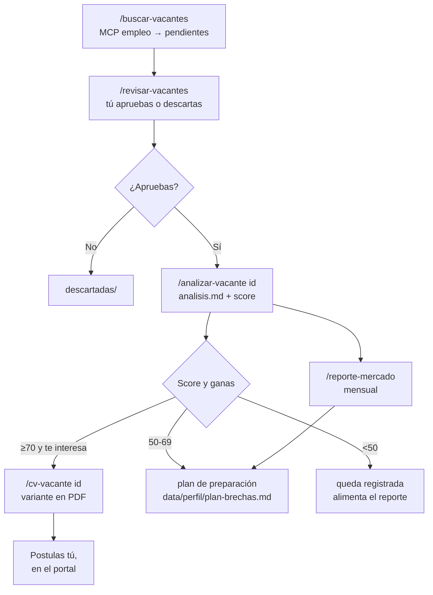

# 6. Flujo completo de trabajo

Dos ciclos: uno de arranque (se hace una vez) y uno operativo (semanal).

## 6.1 Ciclo de arranque

Objetivo: que el sistema sepa quién eres con evidencia, no con supuestos.

```
/auditar-github ────────► data/audit/stack_inventory.json   (tu stack real)
/sincronizar-credenciales ► data/credenciales/consolidado.json (tus credenciales)
/entrevista-cv ─────────► data/perfil/entrevista-reclutador.md
                          rendercv/src/cv/<CANDIDATO>.{es,en}.yaml (aprobado por ti)
/reporte-mercado ───────► data/mercado/reporte-<mes>.md
```

Orden recomendado y por qué:

1. **`/auditar-github`** primero. Sin el inventario, el agente no puede separar
   "lo sé hacer" de "lo vi en un tutorial". Este paso descubre contradicciones
   entre lo que dice tu CV y lo que tus repos demuestran.
2. **`/sincronizar-credenciales`** después. Las credenciales son evidencia
   aceptada aunque no haya repo (por ejemplo, un curso de AWS sin proyecto
   público).
3. **`/entrevista-cv`** al final de la evidencia. El reclutador-mentor entrevista
   por bloques, marca cada dato como confirmado o por confirmar, y solo entonces
   propone cambios al CV.
4. **`/reporte-mercado`** cuando ya tengas 20-30 vacantes guardadas. Antes de eso
   el agregado no dice nada.

Cierre del arranque:

```powershell
tools\.venv\Scripts\python.exe tools\rendercv\renderizar.py preview
```

Revisa los 4 PDFs, ajusta, y cuando estés conforme:

```powershell
tools\.venv\Scripts\python.exe tools\rendercv\renderizar.py release --version v1.0.0
```

## 6.2 Ciclo operativo



Los cuatro puntos de control humano, marcados por las reglas del workspace:

1. **La vacante.** `empleo_marcar` solo lo ejecuta el flujo que tú disparas
   (`/revisar-vacantes`). El scout nunca aprueba nada.
2. **El análisis.** El veredicto es una recomendación. Que el score sea 85 no
   significa que el agente postule ni que tú debas hacerlo.
3. **El CV.** `cv-tailor` presenta el PDF y los cambios; el agente no declara
   "listo para enviar".
4. **GitHub público.** Cambiar la descripción de un repo, sus topics o su README
   altera tu imagen pública: se propone y se aprueba, nunca se aplica solo.

## 6.3 Un día concreto, paso a paso

**Paso 1 — Barrido.** Escribes `/buscar-vacantes`. El scout ejecuta cuatro
búsquedas con `nivel: "junior"` y te devuelve algo así:

```
Nuevas guardadas: getonboard 6, remotive 3, remoteok 0, greenhouse 2
Filtradas por seniority: 41
Errores: ninguno

Top candidatas
1. getonboard-8c31f2aa — Support Engineer I — Cloud (LatAm, remoto)
2. greenhouse-canonical-1f90c3e2 — Associate Linux Support Engineer (worldwide)
...
```

Si `filtradas_por_seniority` es alto y `nuevas_guardadas` es 0, no es que no
haya mercado: es que los portales devuelven senior primero. Cambia el vocabulario
(ver la skill `mercado-laboral`) y vuelve a intentar.

**Paso 2 — Triaje.** `/revisar-vacantes` te pasa 5 vacantes con título, empresa,
portal, fecha, región y 2-3 líneas de requisitos. Respondes `a`, `d` o `s`, y el
agente mueve el archivo en `data/` en el momento.

**Paso 3 — Análisis.** `/analizar-vacante getonboard-8c31f2aa`. El analista:

- extrae requisitos obligatorios y deseables;
- aplica la rúbrica (60/25/10/5) contra tu inventario y tus credenciales;
- escribe `data/vacantes/aprobadas/getonboard-8c31f2aa/analisis.md`;
- guarda `fit: {score, veredicto, analisis}` en el JSON;
- corre `tools/mercado/agregar.py` para refrescar el agregado.

Sales con una línea tipo: `TOTAL: 72/100 → postular` y tres brechas con plan.

**Paso 4 — CV.** `/cv-vacante getonboard-8c31f2aa`. El tailor crea:

```
rendercv/tailored/<empresa>-<rol>/
├── cv.es.yaml
├── vacante.ref.json
├── notas-fit.md
└── output/<CANDIDATO>-<empresa>-<rol>.pdf
```

`notas-fit.md` es tan importante como el PDF: dice qué reordenó, qué omitió y
qué requisito de la vacante **no** puedes cubrir. Eso es lo que te permite
prepararte para la entrevista en lugar de descubrirlo ahí.

**Paso 5 — Postulas tú.** Desde el portal, con el PDF aprobado. El sistema no
envía nada.

**Paso 6 — Cierre mensual.** `/reporte-mercado` agrega todo lo analizado y
`reclutador-mentor` lo convierte en `data/perfil/plan-brechas.md`: máximo tres
frentes activos, cada uno con señal de cierre.

## 6.4 Cadencia sugerida

| Frecuencia | Acción |
|---|---|
| 2-3 veces por semana | `/buscar-vacantes` + `/revisar-vacantes` |
| Cuando apruebas algo | `/analizar-vacante <id>` |
| Solo si el score lo justifica | `/cv-vacante <id>` |
| Semanal | `/auditar-github` (evidencia nueva) + `/sincronizar-credenciales` |
| Mensual | `/reporte-mercado` + actualizar `plan-brechas.md` |
| Al cerrar una brecha | `/cv-general` y, si quieres, release del CV base |

## 6.5 Artefactos por etapa

| Etapa | Archivo | ¿Versionado? |
|---|---|---|
| Búsqueda | `data/vacantes/pendientes/<id>.json` | Sí |
| Decisión | movimiento entre carpetas de `data/vacantes/` | Sí |
| Análisis | `data/vacantes/aprobadas/<id>/analisis.md` + `fit` en el JSON | Sí |
| Tailoring | `rendercv/tailored/<carpeta>/` | Sí |
| Render | `rendercv/tailored/<carpeta>/output/` | Sí |
| Release del CV | `rendercv/versions/<version>/` | Sí |
| Preview | `rendercv/build/preview/` | No (temporal) |
| Entrevista y plan | `data/perfil/*.md` | Sí |
| Mercado | `data/mercado/*` | Sí |

Versionar `data/` es deliberado: dentro de seis meses querrás saber qué vacantes
descartaste y con qué criterio, y el historial de git te lo dice.

## 6.6 Señales de que el sistema está funcionando

- El CV no declara nada que no esté en el inventario o en una credencial.
- Cada vacante aprobada tiene su `analisis.md` antes de generar un CV.
- `notas-fit.md` menciona al menos una brecha. Si nunca hay brechas, el análisis
  es superficial.
- El reporte de mercado cambia mes a mes. Si no cambia, o no estás buscando lo
  suficiente o la taxonomía quedó corta.
- Tú postulas; el agente no.
